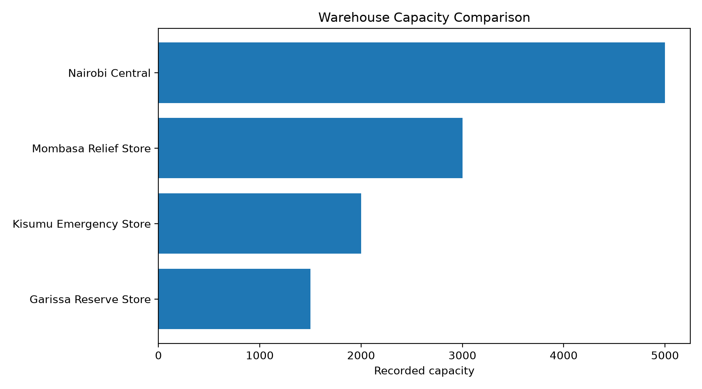
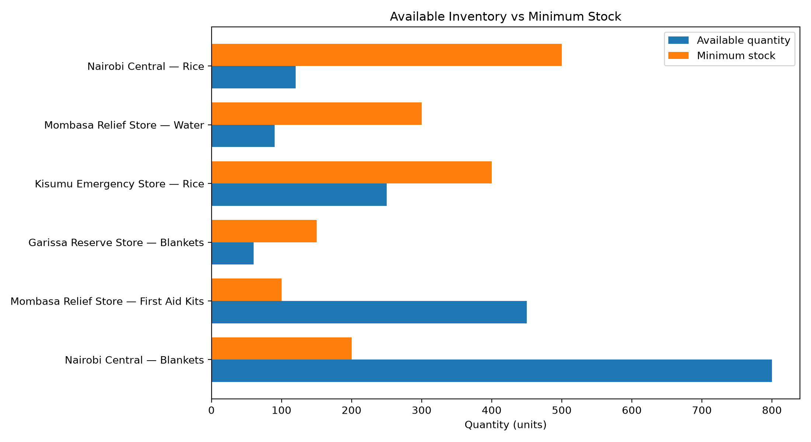
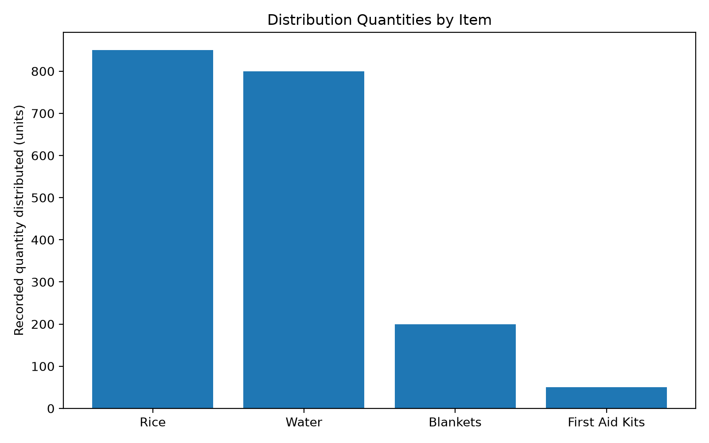

# ReliefData: Humanitarian Warehouse and Distribution Analysis

**Case Study | SQL Analytics | MySQL 8.0**

## 1. Executive Summary

ReliefData is a portfolio project demonstrating how SQL can be used to examine warehouse capacity, monitor inventory against minimum stock thresholds, summarise relief distribution activity, and identify data-quality issues in a humanitarian logistics setting.

The analysis uses a fictional dataset containing four warehouses, six inventory records, and five distribution transactions. The queries were developed using MySQL 8.0 and cover warehouse capacity analysis, conditional stock classification, aggregate reporting, common table expressions (CTEs), joins, and window functions.

The analysis identified three main findings:

- Four of the six inventory records (66.7%) were below their defined minimum stock thresholds.
- The five distribution transactions accounted for 1,900 units distributed across five destinations.
- One distribution transaction, involving 50 units of first-aid kits, had no warehouse reference.

These findings illustrate how SQL-based reporting can help identify potential inventory risks, summarise distribution activity, and flag records requiring further investigation. Because the dataset is small and fictional, the results demonstrate analytical methods rather than real-world humanitarian performance.

## 2. Business Problem and Objectives

### Business problem

Humanitarian logistics teams need reliable information about available stock, warehouse capacity, distribution activity, and the completeness of operational records. Without structured reporting, it can be difficult to identify stock levels below established thresholds, understand recorded distribution patterns, and investigate missing information.

This project models a simplified humanitarian logistics scenario to demonstrate how relational data and SQL can support these tasks.

### Objectives

The analysis aims to:

1. Calculate total warehouse network capacity and each warehouse's share.
2. Compare recorded inventory quantities with minimum stock thresholds.
3. Quantify inventory records below their minimum thresholds and the associated shortfall.
4. Summarise distribution transactions by item and destination.
5. Identify distribution transactions without an assigned warehouse.
6. Compare recorded warehouse-item distribution totals with current inventory records.

## 3. Database Overview

The project uses a MySQL database named `reliefdata`.

| Table | Purpose |
|---|---|
| `warehouses` | Stores warehouse names, locations, and capacity values. |
| `inventory` | Stores available quantities and minimum stock thresholds for warehouse-item combinations. |
| `distributions` | Records distribution quantities, items, destinations, and associated warehouse references. |

The case-study analysis uses SQL joins to connect related tables, aggregate functions to summarise records, `CASE` expressions to classify inventory status, window functions to calculate capacity shares, and a CTE to organise warehouse-level distribution totals.

**Data note:** All records are fictional sample data created for portfolio and learning purposes. They do not represent actual humanitarian operations or verified warehouse conditions in Kenya.

## 4. Warehouse Capacity Analysis

*Figure 1. Recorded capacity across the four fictional warehouses.*

The four warehouses have the following recorded capacities:

| Warehouse | Location | Capacity | Share of total |
|---|---|---:|---:|
| Nairobi Central | Nairobi | 5,000 | 43.5% |
| Mombasa Relief Store | Mombasa | 3,000 | 26.1% |
| Kisumu Emergency Store | Kisumu | 2,000 | 17.4% |
| Garissa Reserve Store | Garissa | 1,500 | 13.0% |
| **Total** | | **11,500** | **100.0%** |

Nairobi Central accounts for the largest share of recorded network capacity at 43.5%, while Garissa Reserve Store accounts for the smallest share at 13.0%.

The analysis uses `SUM(capacity) OVER ()` to calculate the total capacity across all warehouse records and calculates each warehouse's percentage contribution.

### Interpretation

The capacity distribution describes how the recorded capacity is allocated across the four warehouses. It does not establish how much storage space is currently occupied, whether the network has sufficient capacity for demand, or whether capacity is distributed optimally across locations.

## 5. Inventory Risk Analysis

*Figure 2. Available quantities compared with minimum stock thresholds. Records below their thresholds warrant further review.*

Each inventory record was compared with its minimum stock threshold.

| Warehouse | Item | Available | Minimum | Difference | Status |
|---|---|---:|---:|---:|---|
| Nairobi Central | Rice | 120 | 500 | -380 | Below minimum |
| Mombasa Relief Store | Water | 90 | 300 | -210 | Below minimum |
| Kisumu Emergency Store | Rice | 250 | 400 | -150 | Below minimum |
| Garissa Reserve Store | Blankets | 60 | 150 | -90 | Below minimum |
| Mombasa Relief Store | First Aid Kits | 450 | 100 | +350 | Above minimum |
| Nairobi Central | Blankets | 800 | 200 | +600 | Above minimum |

### Inventory risk summary

| Metric | Result |
|---|---:|
| Inventory records analysed | 6 |
| Records below minimum stock | 4 |
| Percentage below minimum | 66.7% |
| Combined shortfall against minimum thresholds | 830 units |

Four of the six inventory records fall below their configured minimum stock levels. Rice at Nairobi Central has the largest numerical shortfall, at 380 units, followed by water at Mombasa Relief Store, at 210 units.

The combined shortfall of 830 units is the sum of the differences between the minimum thresholds and the recorded quantities for below-minimum records. It combines different items and should not be interpreted as a direct measure of relative humanitarian urgency.

### Interpretation

Minimum-stock thresholds can act as monitoring indicators. Records below these thresholds may warrant validation and review by inventory or logistics personnel.

The analysis uses `CASE` to classify each record, arithmetic expressions to calculate stock differences, and conditional aggregation to summarise the number and percentage of below-minimum records.

## 6. Distribution Analysis

*Figure 3. Recorded distribution quantities by item across five sample transactions.*

The five recorded distribution transactions total 1,900 units.

### Distribution by item

| Item | Transactions | Quantity distributed |
|---|---:|---:|
| Rice | 2 | 850 |
| Water | 1 | 800 |
| Blankets | 1 | 200 |
| First Aid Kits | 1 | 50 |
| **Total** | **5** | **1,900** |

Rice has the highest recorded total, with 850 units across two transactions. Water follows with 800 units in one transaction.

### Distribution by destination

| Destination | Transactions | Quantity received |
|---|---:|---:|
| Kisumu East | 1 | 800 |
| Mathare | 1 | 500 |
| Likoni | 1 | 350 |
| Kibera | 1 | 200 |
| Remote Community | 1 | 50 |
| **Total** | **5** | **1,900** |

Kisumu East has the highest recorded quantity, with 800 units, followed by Mathare with 500 units.

### Interpretation

These summaries show how the quantities in the available transaction records are distributed by item and destination. They can support routine reporting and help identify where additional information may be useful.

However, the dataset does not include reporting dates, beneficiary counts, demand estimates, or delivery completion status. Consequently, the analysis cannot establish whether the quantities were timely, sufficient, equitable, or effective in meeting humanitarian needs.

## 7. Data-Quality Findings

The analysis identified one distribution transaction without an associated warehouse reference.

| Metric | Result |
|---|---:|
| Transactions without a warehouse reference | 1 |
| Quantity in those transactions | 50 units |

The affected record concerns 50 units of first-aid kits delivered to the destination recorded as Remote Community. Its warehouse origin cannot be determined from the warehouse reference in the transaction.

### Why this matters

Missing warehouse references can limit the ability to trace stock movements, reconcile warehouse-level totals, and investigate discrepancies between operational records.

A missing reference does not necessarily mean the transaction is invalid. It indicates that additional information or validation may be needed.

The case study therefore excludes transactions with a null warehouse reference from warehouse-level distribution comparisons rather than assigning them to an assumed warehouse.

## 8. Recommendations

Based on the findings and the limitations of the sample dataset, the following are proposed analytical and data-management improvements.

### 8.1 Review below-minimum inventory records

Flag the four records below their configured minimum thresholds for validation. In a real operation, authorised logistics staff would consider demand, stock replenishment schedules, item criticality, and lead times before deciding on action.

### 8.2 Improve inventory monitoring

Use a repeatable SQL report to classify inventory records as below, at, or above minimum stock. Where appropriate, this could be extended into a dashboard with filters for warehouse, item, and stock status.

### 8.3 Strengthen transaction traceability

Review transactions with missing warehouse references and establish clear rules for recording transaction origins. Any correction should be based on verified source information rather than assumptions.

### 8.4 Validate warehouse-item coverage

Compare the combinations of warehouse and item appearing in distribution records with those represented in inventory records. Investigate unmatched combinations to determine whether they reflect incomplete inventory coverage, valid operational circumstances, or data-entry issues.

### 8.5 Extend the data model

For a more complete operational analysis, add transaction dates, stock receipts, opening balances, adjustments, and movement identifiers. These fields would make it possible to examine inventory changes over time and reconcile stock balances against recorded movements.

## 9. Limitations

The results must be interpreted in the context of the following limitations:

- **Small sample:** The dataset contains four warehouses, six inventory records, and five distribution transactions. The findings are illustrative and cannot be generalised to real humanitarian networks.
- **Fictional data:** The records are designed for demonstration and are not evidence of actual shortages or distributions.
- **No time dimension:** Distribution dates and inventory snapshots are unavailable, so trends and time-based comparisons cannot be established.
- **No complete stock-movement history:** Receipts, opening balances, adjustments, losses, and other movements are not represented. Current inventory cannot be reconciled against historical distributions from the available tables alone.
- **Capacity limitations:** Recorded warehouse capacity does not establish utilisation, occupancy, or suitability for particular items.
- **Threshold interpretation:** Minimum stock values are treated as configured reference thresholds; their operational validity has not been independently established.
- **No impact measures:** The data does not include beneficiaries served, delivery timeliness, unmet demand, or outcome indicators. It cannot establish humanitarian effectiveness or equity.

## 10. Conclusion

ReliefData demonstrates how SQL can transform basic relational records into structured analytical outputs. The case study calculates warehouse capacity shares, identifies inventory records below minimum thresholds, summarises distribution quantities, and flags a missing warehouse reference.

Beyond producing summaries, the project demonstrates the importance of interpreting results responsibly. Analytical findings are only as useful as the quality, completeness, and context of the underlying data.

The project can be extended with additional data validation, time-based inventory analysis, automated reporting, and visualisation to demonstrate a broader data analytics workflow.

## Technical Skills Demonstrated

- SQL filtering, sorting, aggregation, and grouping
- `CASE` expressions and conditional aggregation
- `INNER JOIN` and `LEFT JOIN`
- Common Table Expressions (CTEs)
- Window functions and percentage calculations
- `COALESCE` for handling missing aggregate results
- Data-quality checks and analytical interpretation
- Translating query results into evidence-based recommendations

## Project Repository

GitHub: https://github.com/millywanderi/reliefdata-sql-portfolio

**Project status:** In development. This report documents a fictional portfolio case study using MySQL 8.0.
